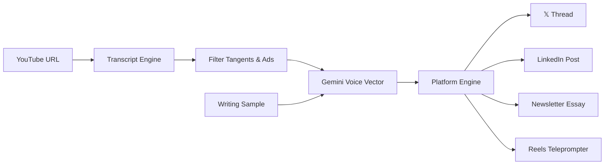

# ContentMultiplier ✦

> **The high-fidelity editorial repurposing engine for video creators.**  
> Transform long-form YouTube videos into native multi-platform writing calibrated to your personal voice.

---

## Overview

Most AI content tools generate generic, robotic summaries packed with cliché emojis and corporate jargon. **ContentMultiplier** treats your video transcript as proprietary source material—isolating core arguments, matching your unique writing cadence, and repackaging ideas into platform-native formats.

### Core Capabilities

* **Full Transcript Extraction:** Directly parses unedited spoken YouTube transcripts, preserving timestamps and stripping filler tangents and sponsorship segments.
* **Persona Voice Vector Mapping:** Analyzes past writing samples to replicate your specific vocabulary, humor, sentence rhythm, and rhetorical structure.
* **4 Channel-Native Outputs:**
  * **𝕏 / Twitter Threads:** Tension-creating hooks formatted into clean, unrolled threads.
  * **LinkedIn Thought Leadership:** Authentic professional narrative posts built for feed engagement.
  * **Long-Form Newsletters & Blogs:** Structured Markdown essays with takeaways and subheadings.
  * **Short-Form Video Scripts:** 60-second teleprompter scripts with B-roll visual cues and pacing notes.
* **Creator Studio Dashboard:** Preset library, tone calibration toggles, live video thumbnail inspection, and 1-click clipboard exports.
* **Saved Content Library:** Searchable archive of previously generated campaign packs.

---

## Tech Stack

* **Framework:** [Next.js 16](https://nextjs.org/) (App Router & Turbopack)
* **Frontend:** React 19, Custom Glassmorphism Design System, CSS Variables
* **AI Engine:** Google Gemini API (`@google/generative-ai`)
* **Database & Auth:** [Supabase](https://supabase.com/) (SSR, Postgres, OAuth)
* **Payments:** [Razorpay](https://razorpay.com/)
* **Typography:** Plus Jakarta Sans & Inter via Google Fonts

---

## Architecture & Pipeline



---

## Getting Started

### 1. Clone & Install

```bash
git clone https://github.com/Dotify71/AI-Content-Multiplier.git
cd AI-Content-Multiplier
npm install
```

### 2. Environment Variables

Create a `.env.local` file in the root directory:

```env
GEMINI_API_KEY=your_gemini_api_key
NEXT_PUBLIC_SUPABASE_URL=your_supabase_url
NEXT_PUBLIC_SUPABASE_ANON_KEY=your_supabase_anon_key
SUPABASE_SERVICE_ROLE_KEY=your_service_role_key
NEXT_PUBLIC_RAZORPAY_KEY_ID=your_razorpay_key_id
RAZORPAY_KEY_SECRET=your_razorpay_secret
```

### 3. Run Development Server

```bash
npm run dev
```

Open [http://localhost:3000](http://localhost:3000) to view the studio.

### 4. Build for Production

```bash
npm run build
npm start
```

---

## License

MIT © [Dotify71](https://github.com/Dotify71)
